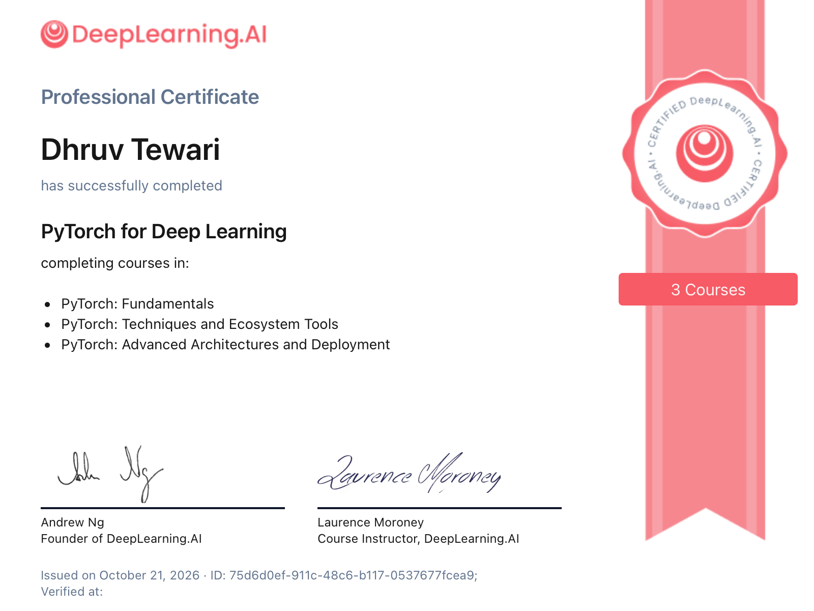
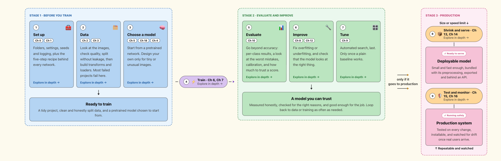

# PyTorch for Deep Learning

I completed the **PyTorch for Deep Learning Professional Certificate** from DeepLearning.AI (issued October 21, 2026). It has three courses:

- **PyTorch: Fundamentals.** Tensors, the training loop, first networks (MLPs and CNNs) and working with image datasets.
- **PyTorch: Techniques and Ecosystem Tools.** Hyperparameter search with Optuna, transfer learning and PyTorch Lightning.
- **PyTorch: Advanced Architectures and Deployment.** Efficient architectures and similarity learning, model interpretability, and shrinking models with pruning and quantization.

The courses also include text-processing modules. This repo covers the computer vision side only.

## Certificate

<p align="center">
  
</p>


## The pocket guide

I was already comfortable with PyTorch, so I used the certification to sharpen the fundamentals and build something I would keep using: a practical, project-ordered guide to computer vision projects in PyTorch, with a small toolkit of reusable helper modules. It is written to stand on its own, so you do not need the courses to follow it. It covers the full project flow, from data checks and leak-free splits through transfer learning, tuning and evaluation to model shrinking, serving and monitoring.



Each step above names the guide chapters to read. Steps 8 and 9 apply only if the model goes to production.

## Chapters

Read the guide once, in order, then use it as a reference. The colour key and a fuller index are in [guide/README.md](guide/README.md).

| # | Chapter | You will learn |
|---|---|---|
| 0 | [Project skeleton](guide/00_project_skeleton.md) | Folder layout, config, seeds, tracking, the whole lifecycle |
| 1 | [The training recipe](guide/01_training_recipe.md) | The five steps behind every network |
| 2 | [Data: inspecting and splitting](guide/02_data_inspection_splitting.md) | Looking at data, quality checks, honest splits |
| 3 | [Data: transforms, loaders and imbalance](guide/03_data_pipeline.md) | Augmentation, datasets and loaders, rare classes |
| 4 | [Designing models](guide/04_models.md) | Layers, CNN blocks, choosing settings, efficient designs |
| 5 | [Transfer learning](guide/05_transfer_learning.md) | Reusing pretrained networks |
| 6 | [Training the model](guide/06_training_loop.md) | The loop, optimizers, schedules, checkpoints |
| 7 | [Training health and speed](guide/07_training_health.md) | Sanity checks, reading curves, faster training |
| 8 | [Beating overfitting](guide/08_overfitting.md) | Diagnose and fix overfitting and underfitting |
| 9 | [Hyperparameter tuning](guide/09_tuning.md) | Automated search with Optuna |
| 10 | [Evaluation](guide/10_evaluation.md) | Metrics, error analysis, calibration, uncertainty |
| 11 | [Embeddings and visual search](guide/11_embeddings.md) | Similarity, triplet loss, retrieval |
| 12 | [Interpretability](guide/12_interpretability.md) | Heatmaps, Grad-CAM, right for the right reason |
| 13 | [Shrinking models](guide/13_optimization.md) | Quantization, pruning, distillation |
| 14 | [Export and serving](guide/14_deployment.md) | Bundles, predictors, ONNX, APIs |
| 15 | [Testing and packaging](guide/15_testing_packaging.md) | Tests, packages, automation |
| 16 | [Monitoring and maintenance](guide/16_monitoring.md) | Drift, labels, retraining |
| 17 | [Beyond classification](guide/17_beyond_classification.md) | Detection, segmentation and other tasks (a map) |
| 18 | [Modern backbones](guide/18_modern_backbones.md) | ViT, ConvNeXt, CLIP, DINO and how to use them |

## Appendices

| | |
|---|---|
| [A: Generating synthetic images](guide/A_generative_images.md) | Diffusion models for extra training data |
| [B: Outdated vs current practice](guide/B_modernization_index.md) | Every purple box in one table |

```
guide/        19 chapters (00 to 18), appendices and an index: start at guide/README.md
cv_toolkit/   generic, reusable modules (copy these into a new project)
  config.py        seeds, device, logging, one config object
  data.py          datasets, transforms, splits, loaders, data checks
  models.py        CNNs, transfer learning, embeddings
  train.py         optimizer/scheduler factories, training loops, checkpoints
  evaluate.py      metrics, error analysis, inference, retrieval
  viz.py           plots
  interpret.py     hooks, saliency, CAM, Grad-CAM
  optimize.py      pruning, quantization, QAT, size/latency
  tuning.py        Optuna search
  lightning_tools.py  PyTorch Lightning version of the pipeline
  deploy.py        bundle, predictor, ONNX export
```

## Using it
```bash
pip install torch torchvision matplotlib pandas        # core
pip install optuna lightning torchmetrics torchinfo     # optional, per module
```
Import with `from cv_toolkit import data, models, train, evaluate`. Copy the folder into your project, or install it as a package (see Chapter 15).


